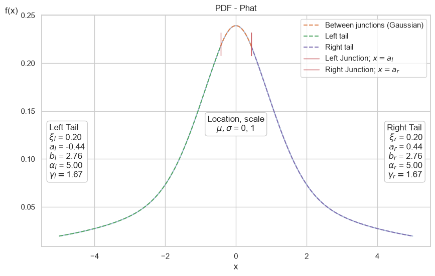
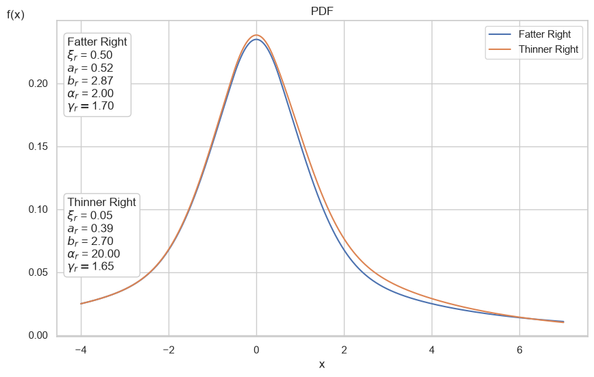

# P.H.A.T. - **P**areto **H**ybrids with **A**symmetric **T**ails #

The **Phat** distribution is a two-tailed, fully continuous probability distribution for data with heavy tails on both sides. Each tail has its own power-law index.

It is an equal-weight mixture of two hybrid Pareto distributions: the Gaussian and generalized Pareto splice of [Carreau and Bengio (2009)](https://www.researchgate.net/publication/226293435_A_hybrid_Pareto_model_for_asymmetric_fat-tailed_data_The_univariate_case), and its mirror image. Mixing hybrid Pareto components with their reflections to model two heavy tails was proposed by Julie Carreau in her [2007 PhD thesis](https://hdl.handle.net/1866/17889) (§3.2), which also applies such mixtures to S&P 500 returns (§4.5). Phat is the smallest member of that family. It has:

+ a Gaussian centre between two junction points. This centre is narrow: it holds only 18% to 28% of the probability for tail shapes between 0 and 1. Outside the junctions the density is a generalized Pareto tail plus a Gaussian remnant of the other component.
+ a generalized Pareto tail on either side, each with its own shape.

The distribution has 4 parameters:

+ `mu`, the location, and `sigma`, the scale, shared by the two components. `sigma` is a scale parameter, **not** the standard deviation: with a shape of 0.2 in both tails the standard deviation is about 4.6 `sigma`.
+ `xi_left`, `xi_right`, the shapes of the two generalized Pareto tails. `1/xi` is the tail index alpha.

Phat does not contain the Gaussian distribution: with both shapes at 0 the tails are exponential.

That describes the default, in which each junction is implied by its tail shape (Carreau and Bengio's construction). From version 1.1 the junctions can also be free: `s_left` and `s_right` place them any distance from the centre, in units of `sigma`, and the weight of each Pareto tail follows from the same smoothness conditions. A junction further out gives a wider Gaussian centre and a tail that starts later and weighs less, with the same shape. The one-tailed hybrid with a free junction is due to [Debbabi, Kratz and El Asmi (2015)](https://doi.org/10.1109/COMNET.2015.7566619).

The **phat-tails** package provides the distribution, methods to fit it to a univariate dataset, and a simulator for ARMA-GARCH forecasts with Phat innovations.

## Documentation ##
[](https://phat.readthedocs.io/en/latest)
[](https://doi.org/10.5281/zenodo.24569278)

## Installation ##

```console
$ pip install phat-tails
```

Version 1.0.0 is not on PyPI yet, so the command above still installs 0.0.11. Until it is, install 1.0.0 from the release tag:

```console
$ pip install "phat-tails @ git+https://github.com/rjskene/phat@v1.0.0"
```

Extras work the same way, for example `"phat-tails[all] @ git+https://github.com/rjskene/phat@v1.0.0"`.

The distribution needs Python 3.11 or later, NumPy and SciPy, and nothing else. Optional extras add the rest:

| Extra | Adds | For |
|---|---|---|
| `phat-tails[speed]` | Numba, tqdm | a faster Hill double bootstrap, with a progress bar |
| `phat-tails[garch]` | `arch`, pandas | building a `Garchcaster` from a fitted `arch` model |
| `phat-tails[fit]` | statsmodels | the alternative `backend='statsmodels'` of `Phat.fit` |
| `phat-tails[plot]` | matplotlib | the plotting helpers |
| `phat-tails[all]` | all of the above | |

## Upgrading from 0.0.x ##

Version 0.0.11 and earlier returned wrong quantiles, random draws, means and variances for `Phat` (the density and CDF were right). These are fixed, so numbers change: see [CHANGELOG.md](CHANGELOG.md) for every change in behaviour. Several arguments were also renamed (`sig` to `sigma`, `xi_l`/`xi_r` to `xi_left`/`xi_right`, `p` to `weights`, and others); the old names still work for one release and warn. `PhatNet`, `PhatLoss` and the rest of the TensorFlow module `phat.learn` are removed; `Phat.fit` with the tail shapes held fixed does the same job without TensorFlow.

## Quickstart ##

```python
import numpy as np
import phat as ph
```

The distribution is the class `Phat`, which follows the conventions of the [continuous distributions in scipy.stats](https://docs.scipy.org/doc/scipy/tutorial/stats/continuous.html#continuous-distributions-in-scipy-stats).

```python
mu, sigma, xi = 0, 1, 1/5
phat_dist = ph.Phat(mu, sigma, xi, xi)
```

Below is the density, with the Gaussian piece between the two junction points and the two generalized Pareto tails marked.



Each tail can have its own shape. Here two Phat distributions share a left shape of 1/2; one has a right shape of 1/2, the other 1/20.

```python
dist1 = ph.Phat(mu, sigma, xi_left=1/2, xi_right=1/2)
dist2 = ph.Phat(mu, sigma, xi_left=1/2, xi_right=1/20)
```



`Phat` has the usual methods: `pdf`, `cdf`, `sf`, `ppf`, their logarithms, `rvs`, `mean`, `var`, `std` and expected shortfall. Scalars in give scalars out.

```python
phat_dist = ph.Phat(0, 1, xi_left=1/5, xi_right=1/4)
phat_dist.pdf(10)
```

    np.float64(0.004829940665997996)

```python
phat_dist.cdf([.05,1,-0.1])
```

    array([0.51144212, 0.70624103, 0.47567736])

```python
phat_dist.ppf(np.linspace(0,1,5))
```

    array([       -inf, -1.29990407,  0.00205   ,  1.31123432,         inf])

```python
phat_dist.mean(), phat_dist.std()
```

    (0.07777227859374136, 4.904970449920037)

The scale `sigma` is 1 here; the standard deviation is 4.9.

Random draws are exact (a component is picked, then its CDF is inverted) and reproducible with `random_state`. `std_rvs` returns standardized draws, `(x - mean) / std`.

```python
phat_dist.rvs(5, random_state=42)
```

    array([ 3.50281185,  0.62586189,  5.26354801, -0.01229218, -6.60785272])

## Fitting ##

```python
x = phat_dist.rvs(20_000, random_state=1)

res = ph.Phat.fit(x)                                 # full four-parameter MLE
res = ph.Phat.fit(x, xi_left=0.2, xi_right=0.25)     # two-stage: tail shapes held fixed
res.params, res.bse, res.conf_int()                  # estimates, standard errors, intervals
res.dist                                             # the fitted Phat
```

`Phat.fit` maximises the likelihood with SciPy and reports standard errors. On equity returns the full MLE gives much smaller tail shapes than tail-index estimators do, so the two-stage form is also provided: estimate the two tail shapes first, for example with

```python
xi_left, xi_right = ph.two_tailed_hill_double_bootstrap(x)
```

and hold them fixed while the location and scale are fitted.

The junctions can be estimated as well:

```python
res = ph.Phat.fit(x, junction='free')                  # one junction distance for both sides
res = ph.Phat.fit(x, junction='free', per_side=True)   # one per side
res = ph.Phat.fit(x, xi_left, xi_right, junction='free', per_side=True)   # two-stage, junctions fitted
res.dist.s_left, res.dist.s_right                    # junction distances, in units of sigma
```

With the implied junction a tail shape also fixes where its tail starts and how much probability it holds, so it has to describe the shoulders of the data as well as the extremes. On S&P 500 daily returns since 1950, estimating one junction distance raises the log-likelihood by about 290 and brings the tail shapes off the zero bound; see the [fitting notebook](https://phat.readthedocs.io/en/latest/notebooks/mle_fit.html).

The package also provides `ph.Garchcaster`, which simulates forecasts from ARMA and GARCH models with Phat innovations.

## Citing ##

Each release is archived on Zenodo. Cite the version you used; version 1.0.0 is [10.5281/zenodo.24569279](https://doi.org/10.5281/zenodo.24569279). The DOI [10.5281/zenodo.24569278](https://doi.org/10.5281/zenodo.24569278) covers all versions and resolves to the latest.

Citation metadata is in [CITATION.cff](CITATION.cff); GitHub shows it under "Cite this repository".

## Also Check Out ##

+ [tail-estimation](https://github.com/ivanvoitalov/tail-estimation)
    + built as part of [Ivan Voitalov et al (2019)](https://journals.aps.org/prresearch/pdf/10.1103/PhysRevResearch.1.033034) on tail index estimation techniques for power law phenomenon in scale-free networks
    + `two_tailed_hill_double_bootstrap` is adapted from this package
+ [evmix](https://www.jstatsoft.org/article/view/v084i05), an R package of extreme value mixture models, including the hybrid Pareto and normal models with two generalized Pareto tails
+ [thresholdmodeling](https://github.com/iagolemos1/thresholdmodeling) for a package on manual Peak-over-Threshold (PoT) analysis.

## Licence ##

MIT. See [LICENSE](LICENSE).
